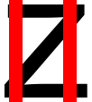

Small research project I have/had going on with my university.

## Goals

#### Overview
Quantify the rhythm of texts, based on the language and font.

#### Horizontal rhythm

Given a text, we want to extract the "irregularities" that break up the horizontal rhythm, meaning measure fluency by looking at the "tall" and "lower" parts of each line of text. For this, we arrange a separation line which isolates the tall and lower parts of each letter, and derive statistics from both the lower and upper part of the line of text.

<!-- 

 -->

  
  

#### Vertical rhythm

###### (still ongoing)

Given a text, we want to measure the regularities of the "vertical rhythm" of the text. For this, we assign each letter with a custom bar profile, where one would imagine the most "vertical mass" to be present. Given the text, one then uses something like optical character recognition to draw the bars at correct positions and derives statistics from this.

  
  

